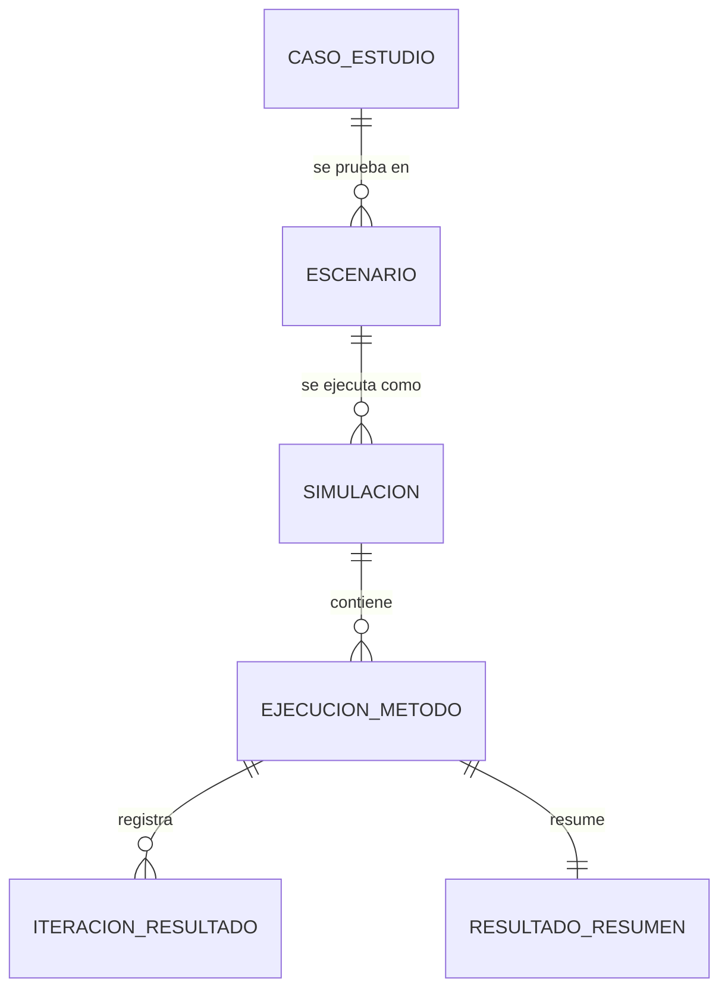

# SIMTELE-RISK: Informe de avance, semana 1

**Modelos, teoría de errores y sistemas lineales** · Materia: Métodos Numéricos · Participantes: ver `estudiantes.json`

> Contexto académico inspirado en Mi Teleférico, La Paz. Los escenarios son hipotéticos y los datos sintéticos: no describen fallas verificadas de la empresa.

## 1. Alcance entregado

| Compromiso | Estado | Evidencia |
|---|---|---|
| Planteamiento de los 4 casos y relación entre modelos y métodos | Hecho | `backend/simtele/modulos.py`, sección 2 |
| Teoría de errores transversal | Hecho | `backend/simtele/numerico/errores.py`, sección 3 |
| Jacobi, Gauss-Seidel, LU, gradiente conjugado y referencia directa | Hecho | `backend/simtele/numerico/sistemas.py`, sección 4 |
| Pruebas de 3 escenarios en un caso y definición en los otros | Hecho | Módulo 2 ejecutado; módulos 1, 3 y 4 definidos |
| Prototipo web con 4 módulos, modal de estudiantes y DER inicial | Hecho | `frontend/`, `database/schema.sql` |

La consigna pide este avance en PDF: este archivo Markdown se puede exportar directamente.

## 2. Modelos de los cuatro casos

| Módulo | Modelo | Variables y unidades | Referencia | Métodos |
|---|---|---|---|---|
| 1. Detención | dx/dt = v; dv/dt = −a(v, t); v(t_det) = 0 | x [m], v [m/s], a [m/s²], t [s] | v = v₀ − at; t_det = v₀/a; d = v₀²/(2a) | Heun, RK4; bisección, Newton, secante; trapecio, Simpson, Romberg |
| 2. Deterioro | D(t) = D₀ + αt + βt²; D(t) = D_u; A x = b | D [%], t [meses] | Raíz de la cuadrática; x\* prefijada | Raíces y sistemas lineales |
| 3. Oscilaciones | m x″ + c x′ + k x = F(t); I = ∫x² dt | x [m], m [kg], k [N/m], c [N·s/m], F [N] | x = e^(−ζω₀t)[C₁cos ω_d t + C₂sin ω_d t] | Heun, RK4; trapecio, Simpson, Romberg |
| 4. Sensores | p(t_i) = y_i; e = \|p(t) − y(t)\| en puntos ocultos | t [s], y [u] | Señal analítica | Lagrange, Newton, spline natural |

**Hipótesis.** Módulo 1: masa puntual y recorrido rectilíneo. Módulo 2: indicador hipotético cuadrático y calibración sin ruido. Módulo 3: oscilador lineal de un grado de libertad. Módulo 4: señal conocida y ruido con semilla fija.

### Matriz de escenarios definida

| Módulo | NORMAL | ESTRÉS | MAL CONDICIONADO |
|---|---|---|---|
| 1 | v₀ = 5 m/s, a = 2.5 m/s², h = 0.1 s | v₀ = 7 m/s, a = 1.2 + 0.05v², h = 0.5 s | Frenado plano: raíz múltiple |
| 2 | I + 0.1 L, n = 6 | I + 5 L, n = 40 | Hilbert n = 8; curva casi tangente |
| 3 | Vibración libre, ζ = 0.05, h = 0.05 s | Ráfaga cerca de resonancia, h = 0.5 s | ζ = 0.005 en el flanco de resonancia |
| 4 | sin(t), 17 muestras | Senoidal amortiguada con ruido, 31 muestras | Pulso de Runge, 21 nodos uniformes |

Un escenario mal condicionado es un subexperimento numérico, no un fenómeno físicamente más peligroso. Se distinguirá de ESTRÉS y de un fallo de convergencia.

## 3. Teoría de errores transversal

| Medida | Fórmula | Aplicación |
|---|---|---|
| Absoluto | E_a = \|x_ref − x\|; vectorial ‖x_ref − x‖₂ | Todos los módulos |
| Relativo | E_r = E_a/\|x_ref\|; se omite si x_ref = 0 | Todos los módulos |
| Porcentual | E_% = 100 E_r | Tablas de resultados |
| Residual | ‖b − A x‖₂/‖b‖₂; \|f(x)\| en raíces | Sistemas, raíces |
| Sensibilidad | κ = \|δS/S\| / \|δE/E\| | Perturbación de entradas |

**Ejemplo manual.** x_ref = 2 y x = 1.5: E_a = 0.5; E_r = 0.25; E_% = 25 %.

## 4. Sistemas lineales

### 4.1 Métodos y condiciones de convergencia

```
Jacobi:          x_i⁺ = (b_i − Σ_{j≠i} a_ij x_j) / a_ii
Gauss-Seidel:    x_i⁺ = (b_i − Σ_{j<i} a_ij x_j⁺ − Σ_{j>i} a_ij x_j) / a_ii
LU:              P A = L U;  L z = P b;  U x = z
Gradiente conj.: α = rᵀr/pᵀAp;  x⁺ = x + αp;  r⁺ = r − αAp;  p⁺ = r⁺ + (r⁺ᵀr⁺/rᵀr) p
```

- Jacobi converge si y sólo si ρ(I − D⁻¹A) < 1. Ser SPD no basta.
- Gauss-Seidel converge para toda matriz SPD.
- Gradiente conjugado exige SPD. Termina en a lo sumo n pasos en aritmética exacta.

Criterio de parada de los iterativos: ‖b − Ax‖₂/‖b‖₂ ≤ tol.

### 4.2 Ejemplo manual de 4 × 4

```
    | 4 1 0 0 |        |  1  |        |  2   |
A = | 1 4 1 0 |   x* = | -2  |    b = | -4   |     κ₂(A) = 2.359
    | 0 1 4 1 |        |  3  |        | 10.5 |
    | 0 0 1 4 |        | 0.5 |        |  5   |
```

**Primer barrido desde x⁰ = 0.**

| Método | x₁ | x₂ | x₃ | x₄ | ‖x − x\*‖₂ |
|---|---|---|---|---|---|
| Jacobi | 2/4 = 0.5 | −4/4 = −1 | 10.5/4 = 2.625 | 5/4 = 1.25 | 1.398 |
| Gauss-Seidel | 2/4 = 0.5 | (−4 − 0.5)/4 = −1.125 | (10.5 + 1.125)/4 = 2.90625 | (5 − 2.90625)/4 = 0.5234 | 1.012 |

**LU sin intercambios.** l₂₁ = 0.25, u₂₂ = 3.75, l₃₂ = 0.26667, u₃₃ = 3.73333, l₄₃ = 0.26786, u₄₄ = 3.73214. Con L z = b: z = (2, −4.5, 11.7, 1.86607). Con U x = z, en sustitución hacia atrás: x₄ = 0.5, x₃ = 3, x₂ = −2, x₁ = 1. ✓

**Gradiente conjugado, primer paso.** r⁰ = p⁰ = b; rᵀr = 155.25; A b = (4, −3.5, 43, 30.5); pᵀAp = 626; α = 0.2480; x¹ = (0.4960, −0.9920, 2.6040, 1.2400).

`backend/tests/test_semana1.py` comprueba los barridos de Jacobi y Gauss-Seidel, la factorización LU y la solución exacta.

### 4.3 Matrices de referencia (módulo 2)

- **NORMAL y ESTRÉS:** A = I + λL, con L el laplaciano de un camino de n tramos: 1 en los extremos y 2 en el resto de la diagonal, −1 entre vecinos. Es SPD, con autovalores en [1, 1 + 4λ). x\*_i = 20 + 10 sin(2πi/n) % de desgaste hipotético.
- **MAL CONDICIONADO:** H_ij = 1/(i + j + 1), Gram de la base monomial en [0, 1]; x\* = (1, …, 1).

En todos los casos b = A x\*.

### 4.4 Resultados por escenario

Generados por `python -m backend.simtele.experimentos`.

| Escenario | n | κ₂(A) | ρ(T_J) | ρ(T_GS) | tol | Amplificación máx. medida de δb en x |
|---|---|---|---|---|---|---|
| NORMAL | 6 | 1.373 | 0.1516 | 0.0230 | 1e-10 | 1.009 |
| ESTRÉS | 40 | 20.97 | 0.9078 | 0.8241 | 1e-12 | 1.017 |
| MAL CONDICIONADO | 8 | 1.526e+10 | 6.042 | 1.000 | 1e-10 | 1.319e+10 |

| Escenario | Método | Iter. | ¿Convergió? | ‖x − x\*‖₂ | Error relativo | Residuo relativo |
|---|---|---|---|---|---|---|
| NORMAL | Jacobi | 13 | Sí | 1.106e-09 | 2.129e-11 | 2.127e-11 |
| | Gauss-Seidel | 8 | Sí | 1.570e-09 | 3.022e-11 | 3.169e-11 |
| | LU con pivoteo parcial | 1 | Sí | 7.944e-15 | 1.529e-16 | 9.584e-17 |
| | Gradiente conjugado | 5 | Sí | 8.140e-15 | 1.567e-16 | 1.728e-16 |
| ESTRÉS | Jacobi | 285 | Sí | 1.326e-10 | 9.887e-13 | 9.799e-13 |
| | Gauss-Seidel | 147 | Sí | 1.146e-10 | 8.545e-13 | 8.488e-13 |
| | LU con pivoteo parcial | 1 | Sí | 2.562e-14 | 1.910e-16 | 8.899e-16 |
| | Gradiente conjugado | 22 | Sí | 3.398e-14 | 2.533e-16 | 2.044e-15 |
| MAL COND. | Jacobi | 128 | No: diverge | 3.426e+100 | 1.211e+100 | 9.076e+99 |
| | Gauss-Seidel | 5000 | No: máx. iter. | 3.350e-02 | 1.184e-02 | 2.185e-07 |
| | LU con pivoteo parcial | 1 | Sí | 3.394e-07 | 1.200e-07 | 2.677e-17 |
| | Gradiente conjugado | 8 | Sí | 4.236e-04 | 1.498e-04 | 6.903e-11 |

### 4.5 Lectura de resultados

- **NORMAL y ESTRÉS:** Gauss-Seidel requiere cerca de la mitad de las iteraciones de Jacobi, coherente con ρ_GS ≈ ρ_J² en matrices tridiagonales. Gradiente conjugado es el iterativo más rápido. El coste de LU crece con n³, relevante para sistemas grandes.
- **MAL CONDICIONADO, condicionamiento:** LU termina con residuo de 2.7e-17 y error de 3.4e-07, unas 1e10 veces mayor, coherente con κ₂. Un residuo pequeño no implica una solución precisa.
- **MAL CONDICIONADO, convergencia:** Jacobi diverge porque ρ(T_J) = 6.04 > 1. Es una propiedad del método sobre esa matriz. Gauss-Seidel sí converge en teoría, pero ρ ≈ 1 hace que no termine en 5000 iteraciones. Son fenómenos distintos del mal condicionamiento.

## 5. DER inicial



El script completo está en `database/schema.sql`, con los campos de la consigna, claves foráneas y restricciones `CHECK`. `database/tests/test_schema.py` comprueba su creación e integridad.

## 6. Ejecución

Desde esta carpeta:

```bash
pip install -r backend/requirements.txt
```

```bash
python -m backend.simtele.experimentos
```

```bash
python -m pytest
```

```bash
python -m http.server 8000
```

Abrir `http://localhost:8000/frontend/`. El servidor se ejecuta desde esta carpeta para que el modal lea `estudiantes.json`.

Resultado actual de las pruebas: 21 superadas.

## 7. Plan para la semana 2

1. Implementar raíces, integración, EDO e interpolación con sus pruebas analíticas.
2. Conectar la base de datos con la API y guardar ejecuciones completas.
3. Ejecutar NORMAL y ESTRÉS en los cuatro módulos, con tablas y dos gráficos por módulo.
